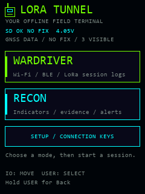
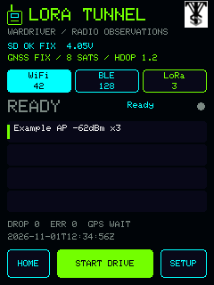
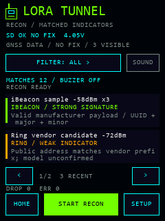
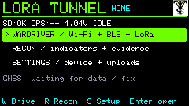
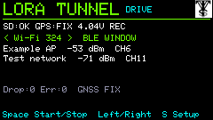
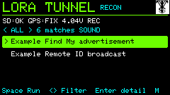

# LORA Tunnel

**BETA · Cardputer ADV 0.4.0-beta.1 · Heltec published 0.3.0-beta.1**

**Development branch: 0.5.0-dev combined mesh reception.** Current source adds a Meshtastic / MeshCore / Both selector, slow profile switching, local Meshtastic node/position/text/device-telemetry decoding and MeshCore public-advert decoding with signature verification. Raw packets and receive settings remain in each SD record. This development work does not update the published binaries or web installer. Known encryption/protocol gaps and physical acceptance checks are recorded in the [combined mesh guide](docs/COMBINED_MESH.md).

LORA Tunnel provides a handheld field terminal for the [Heltec WiFi LoRa 32 Expansion Kit V2 / V4-R8](https://heltec.org/project/v4-r8-ex/) and a dedicated [Cardputer ADV + Cap LoRa-1262 (U214) build](docs/CARDPUTER_ADV.md). Its primary **Wardriver** mode records nearby radio observations to microSD. A separate passive **Recon** mode presents matched indicators, their evidence and optional buzzer alerts. Capture runs on the device without a laptop, phone or Kismet server.

**Cardputer ADV 0.4.0-beta.1 is a public beta with scoped hardware validation.** It has a compact 240 × 135 keyboard interface, U214 LoRa/GNSS support, an 8 MB/no-PSRAM profile and separately packaged factory/Launcher binaries. [Cardputer setup and controls](docs/CARDPUTER_ADV.md) · [Acceptance and release checklist](docs/CARDPUTER_RELEASE.md).

**Published Heltec 0.3.0-beta.1 remains unchanged.** Its GPS fix and short Wi-Fi/BLE capture were measured on the actual Heltec; region saving, logo, power Cancel/sleep and USER wake also have scoped user confirmation. Restart retention, independent geotagged SD readback and sustained-drive acceptance remain separate. These results do not certify Cardputer hardware. [Versioned Heltec evidence](docs/VALIDATION.md).

| Home | Wardriver | Recon |
| --- | --- | --- |
|  |  |  |

*These are renders of the actual UI drawing code with synthetic sample values, not device photos or captured networks. The renderer uses the firmware’s bitmap font; host rasterization can still differ from the device. [Interface views and rendering notes](assets/ui/README.md).* The green radio remains the project logo. The interface also displays the supplied official VTS logo in its upper-right header as a separate brand mark.

[Cardputer factory BIN](https://github.com/valleytechsolutions/LORA-Tunnel/releases/download/v0.4.0-beta.1/LORA-Tunnel-0.4.0-beta.1-Cardputer-ADV-LoRa1262-FACTORY-0x0.bin) · [Cardputer Launcher application BIN](https://github.com/valleytechsolutions/LORA-Tunnel/releases/download/v0.4.0-beta.1/LORA-Tunnel-0.4.0-beta.1-Cardputer-ADV-LoRa1262-LAUNCHER-APP.bin) · [Release and checksums](https://github.com/valleytechsolutions/LORA-Tunnel/releases/tag/v0.4.0-beta.1)

[GitHub source](https://github.com/valleytechsolutions/LORA-Tunnel) · [Web installer](https://valleytech-lora-tunnel.pages.dev/) · [Project page](https://valleytechsolutions.tech/pages/lora-tunnel)

[User guide](docs/USER_GUIDE.md) · [Web installer guide](docs/WEB_FLASHER.md) · [Prepare the SD card](sdcard/README.md) · [Recovery](docs/RECOVERY.md) · [Hardware](docs/HARDWARE.md)

## What the beta does

| Area | Implemented | Current limit |
| --- | --- | --- |
| Wi-Fi | Passive 2.4 GHz AP observations: BSSID, available SSID, channel, RSSI and security metadata | US channels 1–11; no 5/6 GHz radio; Wi-Fi and BLE share scheduled radio time |
| BLE | Passive advertisements with address type, RSSI and available names/service/manufacturer data | Random addresses are not permanent identities; scanning is time-sliced with Wi-Fi |
| LoRa | Region choice; current development source adds combined Meshtastic/MeshCore reception, protocol-specific decoding, profile snapshots and slow hopping | One receive profile at a time; published releases retain header-only capture; see the [supported decoding scope](docs/COMBINED_MESH.md) |
| Recon | Separate passive Wi-Fi/BLE mode, evidence grades, category filters, optional SD rules and [original once-per-session detection sounds](docs/ALERTS.md) in current source | Matches are indicators, not authenticated identity or proof of recording; LoRa is stopped in Recon |
| GNSS | Validity/age handling, UTC when available, checksum/fix/satellite/antenna-status diagnostics | Fresh fix verified on 0.3.0-beta.1; repeated acquisition, loss/reacquisition and geotagged SD/export checks remain pending |
| Storage | Versioned JSONL sessions, bounded queues, buffered writes and visible drop/error counters | Independent SD readback, interruption recovery and sustained-drive acceptance still need completion |
| Exports | Host tools produce eligible WiGLE CSV rows and an unsigned WDGWars mesh candidate payload | WiGLE requires fresh receiver coordinates/UTC; the new decoded mesh log fields still need exporter/service acceptance work |
| Credentials | SD configuration; Heltec touchscreen or Cardputer physical keyboard | Values remain plaintext on the SD card; public packages contain empty examples |

Short device checks have demonstrated display/touch initialization, SD mount, Wi-Fi/BLE observations, LoRa packet reception and session transitions. The user confirmed the separate Wardriver/Recon appearance, earlier flicker fix and subsequently working GPS; a later read-only device check confirmed a fresh fix. Those results do not establish every detection category, new physical-button/shutdown behavior, battery-only operation, upload support or drive-duration reliability. Exact build/test/device evidence and remaining checks are in [VALIDATION.md](docs/VALIDATION.md) and [TEST_CHECKLIST.md](docs/TEST_CHECKLIST.md).

## Upload service preparation

Cardputer 0.4 adds software for **WiGLE, Wardrift and WDGWars** using configured
home Wi-Fi and **an explicit enable setting for each service**. Automatic work
is restricted to idle periods: startup and after a saved capture, with retry
while idle. Capture must be stopped and saving complete before upload work;
starting capture takes priority. Enter WiGLE API name/token, Wardrift token or
WDGWars token only for the services you choose. [Service setup, eligibility,
retry behavior and current test status](docs/UPLOADS.md).

Live service receipts remain unverified for this beta. Uploads are opt-in and
run only while capture is stopped and saved; see the validation notes. The unchanged Heltec 0.3.0-beta.1 release has no uploader.

## Cardputer ADV target

| Home | Wardriver | Recon |
| --- | --- | --- |
|  |  |  |

These are source-rendered synthetic previews, not photographs or physical acceptance evidence.

Build with `python -m platformio run -e cardputer-adv-lora1262`. Follow the
[Cardputer guide](docs/CARDPUTER_ADV.md) for keyboard controls, U214 setup,
region selection, microSD, factory installation and Launcher installation.
The original Cardputer and other caps are not this target. This beta has verified USB application installation and short capture checks;
physical Launcher installation, exact factory/web flashing, battery/sleep/wake,
sustained interactive capture and live upload receipts remain unverified.

## Heltec hardware and first start

This target is the **newer Expansion Kit V2 with V4-R8, 863-928 MHz hardware** (sold for 868/915 MHz operation). Its board configuration selects an ESP32-S3, 16 MB QIO flash and 8 MB OPI PSRAM, SX1262, 240 × 320 touchscreen, GNSS and microSD. V1 pin assignments and firmware are not interchangeable. Match your actual PCB and frequency variant against the [verified hardware notes and official sources](docs/HARDWARE.md).

1. Preserve the existing firmware and board details using the [recovery guide](docs/RECOVERY.md). Confirm the target board and USB port before flashing.
2. Prepare a FAT32 microSD card. Copy `sdcard/lora-tunnel` to the card root, then copy its `config.example.json` to `config.json` **on the card**. Leave real credentials out of the repository.
3. Install through the [web installer guide](docs/WEB_FLASHER.md), or build and flash below.
4. Boot and select the LoRa region for your location, or choose **Skip LoRa** to continue with Wi-Fi/BLE only. Check storage/GNSS status, choose **Wardriver**, and tap **START DRIVE**. Use **STOP + SAVE** and wait for saving to finish before removing the card or power.
5. Copy `/sessions/LT-xxxxxxxx.jsonl` from the card for export. Preserve the original JSONL files.

Fresh installations leave LoRa **UNSET and disabled** until you select a region during setup or in Settings. The selector offers Meshtastic LongFast profiles derived from pinned upstream settings for this high-band kit; US is 906.875 MHz and EU_868 is 869.525 MHz. The selection is saved in device NVS and, when mounted, the SD configuration; the interface reports save failures. A mounted-card write must succeed before the active choice changes. Credentials and other valid settings are preserved. Existing valid US configurations migrate without retuning. A valid SD file takes precedence; invalid existing files recover from a valid backup or leave LoRa disabled. See [region profiles, hardware compatibility and persistence](docs/REGIONS.md).

Use **Settings → Power → Power Off** to confirm a software shutdown: stop capture, finish saving, switch off GNSS/radios/display and enter deep sleep. Press **USER** to wake. The physical POWER button operates a separate battery latch; firmware cannot intercept its roughly three-second hardware cutoff. USB may continue supplying the board after that cutoff. See [shutdown and wake](docs/USER_GUIDE.md#shutdown-and-wake) before removing power.

Recon works with the supplied empty `detection_rules.json`: built-in parsers and a compiled vendor table provide its baseline evidence. Optional SD rules add names, SSID prefixes, OUIs, services and manufacturer identifiers. The 201-row vendor CSV is an attributed reference, **not an automatically loaded runtime database**. See [RECON.md](docs/RECON.md) and the [SD configuration guide](sdcard/README.md).

## Build and flash from source

Install Python and PlatformIO Core 6.2.0, then run these commands from a checkout or unpacked source archive:

```sh
python -m pip install platformio==6.2.0
python -m platformio run -e heltec-v4-r8-tft
python -m platformio device list
```

The pinned pioarduino platform **55.03.312-1** uses **Arduino-ESP32 3.3.12 / ESP-IDF 5.5.5**. Direct library versions are pinned in `platformio.ini`. `core_dir = .pio-core` isolates framework/compiler packages from concurrent projects; keep that setting. `.pio-core` and `.pio` are generated locally and excluded from source releases. The first build needs internet to obtain dependencies; offline capture does not.

After the board and backup checks, replace `PORT` with the confirmed serial port, such as `COM3` on Windows or `/dev/ttyACM0` on Linux. Port numbers are machine-specific.

```sh
python -m platformio run -e heltec-v4-r8-tft -t upload --upload-port PORT
python -m platformio device monitor --port PORT --baud 115200
```

The default esptool 5.4.0 loader failed on the test unit. If normal upload stops at flash-size configuration, use the explicit [legacy-stub 5.4.0 installation fallback](docs/RECOVERY.md#legacy-stub-installation-fallback), with a pinned tool and independent verification. Repeating the same default upload has not resolved that failure.

PlatformIO supplies the matching bootloader, partition and application addresses. **Do not write the application-only `firmware.bin` at address 0.** A web installer uses its matching release manifest and merged image. Firmware does not wait for a serial console to boot. [Stock recovery and image details](docs/RECOVERY.md).

## Logs, exports and diagnostics

The primary record is the versioned native JSONL session. Summaries on screen are bounded; repeated sightings remain separate observations. Receiver coordinates are kept separate from self-reported mesh/Remote ID positions. Unknown/encrypted LoRa payloads remain identifiable without invented names or coordinates. See [LOG_FORMAT.md](docs/LOG_FORMAT.md).

```sh
python tools/export_logs.py wigle path/to/session.jsonl path/to/new-export.csv
python tools/export_logs.py wdgwars-mesh-candidate path/to/session.jsonl path/to/new-candidate.json
```

These commands write new files and report skipped records; they **do not upload**. The WiGLE exporter skips missing/stale fixes, Recon/raw-frame records and, by default, randomized BLE addresses. Sessions without eligible fixes still produce zero WiGLE rows; a confirmed working fix does not bypass the exporter’s freshness and validity checks. The WDGWars exporter requires genuinely decoded mesh identities, advertised node positions, role and forwarding information that the current LoRa decoder does not yet provide. Synthetic examples illustrate schemas, not successful service submissions. [Export requirements and source checks](docs/EXPORTS.md).

Optional USB diagnostics require Python `pyserial` (`python -m pip install pyserial` if needed) and an explicit port:

```sh
python tools/bench_serial.py --port PORT --command status --seconds 10
python tools/bench_gps.py --port PORT --seconds 15
```

The helpers print allowlisted diagnostic fields without coordinates, observed names or credentials. `bench_serial.py --command stop` succeeds only after fresh status reports `running=0 saving=0`; neither helper validates SD file contents or proves a GPS fix. USB is optional during capture. See the [user guide](docs/USER_GUIDE.md) and [GNSS diagnostics](docs/GPS_DIAGNOSTICS.md).

## Development and credits

```sh
python -m pip install -r tools/site-requirements.txt
python -m unittest discover -s tests -p "test_*.py" -v
python -m platformio test -e native
```

Native tests require an available host C++ compiler. Build/host tests and physical acceptance are recorded separately. The 0.4 acceptance priorities are Cardputer GNSS and geotagged-log readback, keyboard/region/shutdown checks, sustained capture/recovery, browser and Launcher installation, and real WiGLE/Wardrift/WDGWars receipts with idle/capture handoff. Richer Meshtastic decoding, LoRa hopping and MeshCore remain later work. [Architecture](docs/ARCHITECTURE.md).

Original LORA Tunnel application code is **MIT licensed** by Valleytech Solutions; see [LICENSE](LICENSE). Source/relinking materials are described in [RELINKING.md](docs/RELINKING.md). Imported components retain their original licenses and notices. The Recon subset comes from **Dragon Detector** and retains **Just Call Me Koko / ESP32Marauder** and **Flock Noir** attribution. **OpenDroneID core C** is included under Apache-2.0. LoRaPipe, Kismet, Meshtastic and SquachWatch are separately identified as architecture/protocol/coverage research where implementation was not copied. Web installation uses **ESP Web Tools**. See [THIRD_PARTY.md](docs/THIRD_PARTY.md) for exact revisions, modifications and notices; this project is independent of those upstream projects and Heltec.
