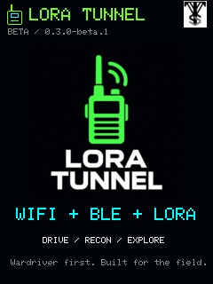
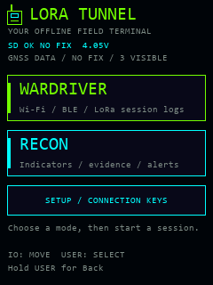
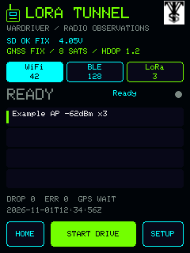
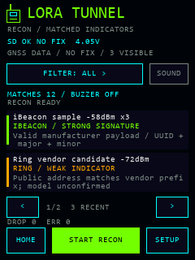
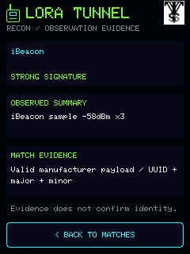
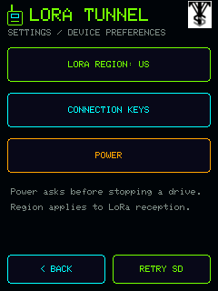
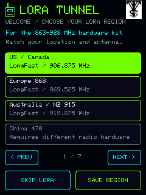
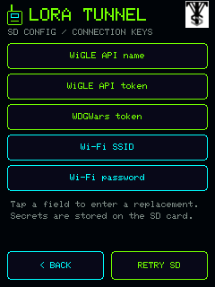
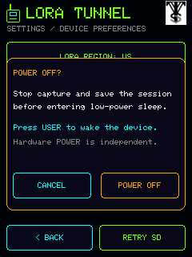
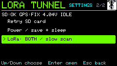

# LORA Tunnel simulated UI previews

These images were generated on 2026-11-01 from the actual `src/ui.cpp` drawing code for **0.3.0-beta.1**. **Every counter, signal value, GPS/UTC/battery state and observation label shown is synthetic sample data.** These are simulated interface views, not photographs, physical-device acceptance evidence or proof that the illustrated devices were detected.

The host harness compiles the current UI implementation against a graphics stub, captures its drawing commands, and rasterizes them with Pillow. It now uses the installed LovyanGFX 1.2.24 **Font0 bitmap glyphs**, replacing the older Consolas approximation. Rounded primitives and PNG resampling can differ from the device library/display. Text, coordinates, colors, controls and image placement come from the firmware. The temporary native harness passed **314 assertions**, including first-run selection, unavailable hardware profiles, modal actions, keyboard cancellation, control bounds and graphics-free navigation. Those assertions are separate from the firmware's native test suite and physical input acceptance.

The original supplied VTS PNG and the existing LORA radio PNG are embedded/read unchanged. The small VTS mark uses the white sprite backing specified by the UI code, making the black original artwork legible on the dark header. Scaling for the display does not rewrite either source image. The LORA radio logo's origin is documented in [IMAGEGEN.md](../IMAGEGEN.md); the retained Font0 notice is [FONT-LICENSE.txt](FONT-LICENSE.txt).

Each individual PNG is **240 × 320 pixels**. `overview.png` enlarges the ten views using nearest-neighbor sampling and visibly labels them as simulated. The `.draw` files preserve the recorded commands. `provenance.json` records the exact UI/header/profile/logo source hashes, host harness hashes and output hashes. Public assets contain no actual captured SSIDs/MACs, receiver coordinates, credentials or personal paths. The empty keyboard is intentional.

| Splash / original logos | Home | Wardriver |
| --- | --- | --- |
|  |  |  |

| Recon | Evidence detail | Settings |
| --- | --- | --- |
|  |  |  |

| First-run region picker | Connection Keys | Keyboard |
| --- | --- | --- |
|  |  |  |

The displayed **FIX**, eight-satellite count, HDOP and UTC are synthetic UI fixtures. Actual GPS evidence is separate: [VALIDATION.md](../../docs/VALIDATION.md) records the physical 0.2.3-dev result and the new build's remaining acceptance checks. Neither this preview nor its selected region proves real reception, a stored configuration, an SD save or successful shutdown/wake.

## Cardputer 0.5.0 previews

The [Cardputer views](cardputer/README.txt) were regenerated from the 0.5.0 drawing code, including the combined-mode Settings row. Their source and output hashes are in [provenance.json](cardputer/provenance.json). The portrait Heltec examples above retain their explicitly dated 0.3.0 layout; current controls are described in the interface guide.

