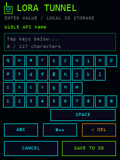
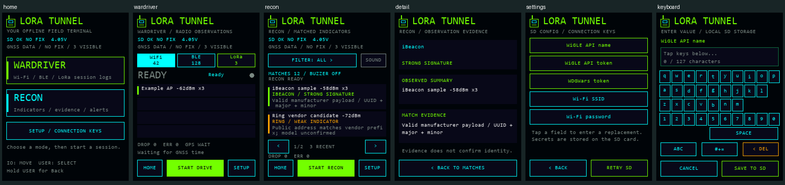

# LORA Tunnel UI renders

These images were generated on 2026-11-01 from the actual `src/ui.cpp` drawing code for 0.2.2-beta.1. **All shown counters, signal values, battery/GNSS state and observation labels are synthetic sample data.** The images are not photographs, physical-device acceptance evidence or proof that the illustrated devices were detected.

The host harness executes the UI state and drawing paths against a graphics stub, captures draw commands, and rasterizes those commands with Pillow. Consolas approximates the embedded Font0 font; rounded rectangle corners are approximated as square corners. Layout coordinates, text, colors and controls come from the firmware. The harness passed its 12 navigation/state contract groups before rendering. No image-generation model was used for these UI renders.

Each individual PNG is 240 × 320 pixels. `overview.png` enlarges the six renders with nearest-neighbor sampling. The `.draw` files preserve their recorded drawing commands; `provenance.json` records the source SHA-256 and output hashes. Public assets contain no actual captured SSID/MAC, GPS coordinates, credentials or personal paths. The empty keyboard is intentional. The separate radio logo's origin is documented in [IMAGEGEN.md](../IMAGEGEN.md).

| Home | Wardriver | Recon |
| --- | --- | --- |
|  |  |  |

| Evidence detail | Setup | Keyboard |
| --- | --- | --- |
|  |  |  |

The rendered GNSS state deliberately says **NO FIX**. It must not be replaced by a working-fix claim based only on the rendering. These screenshots illustrate the interface; [VALIDATION.md](../../docs/VALIDATION.md) records actual build and hardware evidence.
