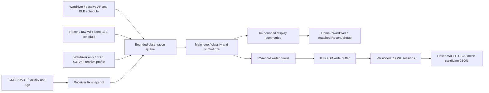

# LORA Tunnel architecture and milestones

This describes the 0.2.2-beta.1 source. Its firmware build and installation have
passed verification; the latest component results total 73 native and 29 Python
tests. The 0.2.0 device bench separately exercised Recon, a stopped/flushed mode
change, Wardriver and final Stop, and the user confirmed both mode views and the
new logo look right. These scoped checks do not complete physical acceptance.
Exact build/device results belong in `VALIDATION.md`. The version is centralized
in `include/version.h`.

The application uses pinned PlatformIO/pioarduino, Arduino-ESP32 3.3.12,
LovyanGFX 1.2.24, NimBLE 2.5.2, RadioLib 7.8.1, TinyGPSPlus 1.1.0 and
ArduinoJson 6.21.5. The local `lib/recon` adapter imports the owner's
MIT-licensed Dragon Detector subset, retaining inherited notices; adjacent
`lib/opendroneid` contains the Apache-2.0 decoder pinned to
`849c03adbe0cdd68997a462fafab397edcfe53f3`. Exact source hashes and attribution
are retained in those libraries. SquachWatch supplies a feature/signature-fact
reference, not copied GPL application code.

Capture operates independently of a laptop, phone or Kismet host. Desktop
exporters consume SD logs after capture. LoRaPipe informs the raw-packet and
metadata separation; LoRaPipe/Kismet application code is not embedded.

## Modes and data flow

Wardriver observes 2.4 GHz APs, BLE advertisements and one LoRa profile.
Recon observes passive Wi-Fi/BLE evidence, filters enabled categories and stops
LoRa reception. A mode change closes the previous session; the user explicitly
starts the new mode. Home/Back navigation alone leaves capture running.
Session generation and mode are attached at admission so delayed callbacks
cannot silently become observations of a later session.

Wardriver preserves ordinary observations. Recon logs enabled-category matches
regardless of its display threshold; `recon.display_min` controls summaries/UI,
not that record-retention decision. Wi-Fi/BLE counters count admitted ingress
observations. `recon_total` counts enabled-category matches, including repeats.
The UI sees only eight recent eligible matches from its bounded summary cache.
Its category selector searches those eight, not historical SD records.

Confidence grades describe evidence. Vendor/name matches remain candidates;
iBeacon describes a packet format, Find My patterns do not uniquely identify
AirTags, and unauthenticated Remote ID broadcasts do not prove physical identity
or flight. Missing per-observation decoded fields remain missing. Raw evidence
and its transport are retained where available. See `RECON.md` for parser
boundaries and per-category qualifications.

## Hardware ownership and scheduling

Pins remain in `board_config.h`. TFT and SD share SPI3 under one mutex; SX1262
uses SPI2. The UI skips display work when the writer owns the bus. Touch polling
still occurs inside the UI path and can be delayed by SD contention. Physical
button polling and `ui::navigation()` require no SPI; actions are queued for the
main loop rather than performing SD/radio work inside UI callbacks.

The SX1262 interrupt only sets a flag. Packet read/rearm takes priority over
ordinary result processing. Wardriver defaults to the confirmed US LongFast
profile: 906.875 MHz, BW250, SF11, CR4/5, preamble 16, fixed sync 0x2B and LNA
bypass. It receives one frequency/modem configuration at a time. Missed RF or
controller packets cannot all be measured by software queue counters.

Wardriver uses passive SDK AP scans over US channels 1–11, default 120 ms per
channel, retaining at most 64 AP results per scan. Excess results count as
drops. Recon receives management and data frames with valid receive status,
removes the four-byte FCS, requires at least the 24-byte header, and uses
transmitter address 2. It retains up to 1,024 bytes with original length and
truncation state. This permits supported beacon/vendor and NAN parsing; an AP
summary alone cannot provide those bytes. Recon visits channels 1–11 in order,
at least 200 ms each: nominally a 2.2-second sweep, extended by main-loop delays
without skipping late channels. The configured BLE window follows, separated
by a 100 ms guard. Wi-Fi is not retuned during an SDK scan/connection attempt.

BLE remains passive, default 2.5-second windows with 100 ms interval / 80 ms window,
duplicate callbacks and no retained NimBLE result list. Passive scanning does
not request scan responses, so some names/services remain unavailable.
Bluetooth Classic, 5 GHz Wi-Fi and simultaneous coverage of every BLE PHY are
not claimed. The scanner uses the legacy path; extended/coded reception is not
enabled. Scan dwell, controller loss, UI latency and combined coverage must
be measured with controlled sources.

## Bounded processing, logs and location

Observation records contain no dynamic strings or pointers. Raw storage is
bounded to 1,024 bytes per record; the Recon API accepts at most 1,024 Wi-Fi bytes
or 512 BLE bytes, and LoRa retains at most 255. BLE retains its ADV/SCAN_RSP
boundary when supplied by the scanner. Truncation/unsupported framing must not
produce a claim that a complete packet was decoded. The 48-record ingress
queue reserves its final eight slots from data frames for management traffic;
deliberate capacity drops increment the visible ingress-drop counter. Two
fixed PSRAM callback scratch records are allocated at initialization.
The SD queue has 32 records with its payload
storage in PSRAM; queue control/task state remain internal. No large allocation
is permitted in radio callbacks.

The main loop maintains 64 least-recently-seen summaries. Eviction removes only
the display summary, not observations already logged. Public and randomized
BLE address types remain distinct. A LoRa candidate sender is prefixed `?`;
unknown packets use a packet fingerprint, not an invented node identity.
Changing signal/location and later sightings remain observations even when the
display suppresses duplicate rows.

The logger uses an 8 KiB write buffer and fixed 8 KiB JSON document, flushing at
least every 2 seconds or when full and closing on Stop. A failed write marks
storage unavailable and conservatively counts the buffered records as dropped.
It cannot prove what a partially successful card write committed. Interrupted
sessions keep their existing file; new sessions receive new random filenames.
Queue saturation, malformed lengths, radio/storage errors, UI skips and maximum
flush duration are counted. SD-driver stalls/watchdog behavior still require
physical testing.

GNSS positions always describe the receiver. Invalid/stale fixes become null;
zero coordinates are not fabricated. UTC is accepted only from a GNSS sentence
no more than 1.5 seconds old, with its age/basis retained. Monotonic time always
exists. AP-scan timestamps describe result delivery, not each beacon's precise
arrival. Raw-frame timestamps have their own observation basis. Remote ID
aircraft and takeoff/fixed/live operator coordinates remain separate from
receiver GPS; future decoded mesh-node positions must also stay separate.
Relayed mesh packets do not establish that the original sender is nearby.

The 0.2.1 diagnostic parser retains complete GSV groups for five supported
talkers (GP, GB, BD, GL and GN). It checks sequence consistency and keeps the
previous completed group, with its age, while a new group is incomplete. Each
report carries visible-satellite count, signal ID, maximum C/N0, present C/N0
count and positive C/N0 count; missing and zero values remain distinct. Talker
or signal reports are not a deduplicated satellite count. Exact `ANTENNA OK`
and `ANTENNA OPEN` TXT status messages are counted separately from unknown
text. These diagnostics retain no coordinates and do not alter fix validity.
The installed 0.2.1 bench received complete groups and `ANTENNA OK`, while
position fix remained unavailable.

## UI, controls and SD configuration

The retained 0.1.2 presentation path uses one 153,600-byte PSRAM framebuffer,
attached to the LovyanGFX sprite without a second full-frame copy. Drawing is
offscreen, followed by one synchronous transfer. Status refreshes at 2 Hz unless
input marks the screen dirty; keyboard/evidence pages are otherwise static.
The user confirmed 0.1.2 fixed the reported flicker and subsequently confirmed
that the distinct 0.2.0 Wardriver/Recon views and clean radio logo look right.
Full input coverage, button operation and drive-duration behavior remain
separate physical checks.

If framebuffer allocation fails, a visible direct-display fallback uses local
updates and clears on page transitions. Physical controls have 30 ms debounce,
a 700 ms USER long-press, no automatic repeat, boot-held suppression and wrap-safe
timing. IO cycles focus, USER selects and long USER goes Back. Touch remains
available when `ui.buttons_enabled=false`. GPIO46 electrical levels remain a
fitted-board check despite passing the portable button tests.

SD configuration/rules are bounded to 16 KiB each, with at most 64 valid custom
rules. Built-in detection works with the shipped empty rule list. Runtime
rules support exact names, SSID prefixes, OUIs, BLE service IDs and manufacturer
IDs; the 201-row vendor CSV is an editable reference, not a runtime importer.
Random/local addresses never supply vendor-prefix evidence.

Defaults: `ui.buttons_enabled=true`, `recon.buzzer=true`,
`recon.display_min=low`, `recon.alert_min=medium`; omitted categories enable all
and an empty array disables all. Alerts require enabled-category evidence at
the alert threshold and an allowed winning rule, with a 30-second retained
identity cooldown and one-second global cooldown. UI mute changes RAM; reboot
reloads the SD setting. Credential storage/keyboard replacement uses checked
temporary-file promotion and preserves a valid backup. Existing damaged radio
configuration with no valid backup disables LoRa; missing configuration uses
the confirmed US defaults.

## Stages and acceptance gates

| Stage | Source capability | Remaining acceptance/work |
| --- | --- | --- |
|1 Hardware | Verified configuration, display/touch/GNSS/SD and voltage/buzzer adapters | Actual PCB/FEM, independent battery boot, input corners/buttons, GPS fix, SD readback/resilience |
|2 Wardriver | Passive Wi-Fi/BLE schedule, fixed queues, JSONL and separate summaries | Controlled-source coverage, timing, dense environments, long drives |
|3 LoRa | Fixed receive-only profile, raw metadata and candidate headers | Known transmitter, LNA comparison, protocol confirmation and payload decode |
|4 Recon/UI | Distinct pages, bounded signatures/Remote ID, SD rules, evidence grades, optional buttons and alerts | Real category/transport comparisons, false positives, buttons, full touch coverage and UI/buzzer latency |
|5 Export/upload | Desktop WiGLE CSV and strictly gated unsigned mesh candidate JSON | Real export acceptance, on-device export, TLS uploader, explicit manual/opt-in automatic upload state |

USB status/start/stop is an optional bounded bench interface; startup does not
wait for it. Diagnostics avoid observed names, coordinates and credentials.
The serial helper verifies recent command state and fails on missing status or
restart/crash diagnostics, but cannot certify radio captures or SD content.

Future upload policy remains unimplemented: configured networks, completed
sessions, validated TLS, no credential logging, independent destination
checkpoints and bounded retries. Native logs must survive failed uploads.
After reliable fixed-profile reception, slow profile hopping can account for
airtime and traffic density. MeshCore and optional known-key Meshtastic payload
decoding remain later work; exported fields must never be fabricated.

## Bounded diagnostic quiet state

The optional `tunnel quiet` USB command requires capture stopped and the logger idle. It stops radio work and sleeps the display/backlight while the loop continues GNSS polling and status commands. It does not change GNSS power, baud, constellation or output configuration. An independent `esp_timer` callback restarts the ESP32 after 90 seconds, including if radio shutdown stalls; `tunnel resume` requests an earlier restart. It is a bounded diagnosis path, not an operating mode or GPS fix. The installed beta's narrow comparison and automatic restart are recorded in [VALIDATION.md](VALIDATION.md).

Original application code is MIT licensed. Imported code and framework components retain their own license and source/relinking requirements; see [THIRD_PARTY.md](THIRD_PARTY.md) and [RELINKING.md](RELINKING.md).
