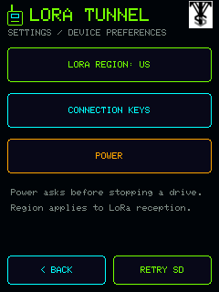
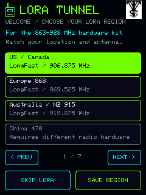
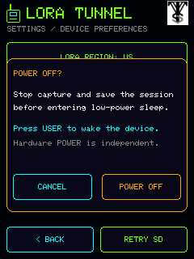

# LORA Tunnel touchscreen and button guide

This is the Heltec touchscreen/button guide. [Cardputer ADV 0.4 uses a separate physical-keyboard interface](CARDPUTER_ADV.md), including per-service upload controls. Its source-rendered previews and hardware acceptance are tracked separately.

This describes the Heltec **0.3.0-beta.1** interface. Build, installation and physical results are recorded separately in [VALIDATION.md](VALIDATION.md). The user previously confirmed the distinct Wardriver/Recon views, clean radio logo and flicker fix, and subsequently confirmed working GPS. A read-only 0.2.3-dev check then verified a fresh 3D fix with five satellites. The new region picker, shutdown/wake flow, VTS header mark and updated touch coverage require their own acceptance checks. Source-rendered previews use synthetic values; they do not prove physical behavior.

| Settings | First-run region picker | Power confirmation |
| --- | --- | --- |
|  |  |  |

*Simulated views generated from the current drawing code, with synthetic values. They are not device photographs or evidence of a completed save/shutdown. [All previews and provenance](../assets/ui/README.md).*

## Home and mode selection

The green radio-logo splash leads to **Home**, with **Wardriver**, **Recon** and
**Settings**. Wardriver is the primary capture mode. Selecting a mode opens its
controls; it does not automatically start a recording. The supplied official VTS mark appears in the upper-right header alongside the project branding; the green LORA radio remains the splash/project logo.

A fresh installation first opens the region picker with **UNSET / LoRa off**. Select a compatible region or choose **Skip LoRa** to reach Home with Wi-Fi/BLE available. A successfully saved Skip is remembered across reboot, without choosing US or enabling the SX1262. An explicit blank UNSET example starts setup again.

Changing to the other mode stops the old session and finishes its queued SD
writes. Start the new mode explicitly after saving completes. Returning Home,
opening Settings, or using Back alone does not stop a running capture. Home shows
which mode is running so it can be reopened.

The screen is prepared in a fixed 153,600-byte PSRAM RGB565 buffer and transferred
once per redraw. Status refreshes at up to 2 Hz; input requests an immediate
redraw. The keyboard and evidence detail are otherwise static. If that
allocation fails, `UI BUFFER LOW: DIRECT DISPLAY` identifies a direct-drawing
fallback. Its full clears occur at page transitions, with local updates and
focus-outline erasure between them.

## Wardriver

- **WiFi**, **BLE** and **LoRa** select the recent-observation view. Their numbers
  count admitted observations, including repeat sightings; they are not unique
  physical-device totals. Complete 32-bit counts fit on the tabs' second line.
- Four rows show recent names/identifiers, RSSI and retained sighting counts.
  These are summaries from a bounded cache, separate from timestamped logs.
- **START DRIVE** begins recording when initialization and storage checks pass.
  **STOP + SAVE** stops capture and finishes queued writes.
- **HOME** returns to mode selection; **SETTINGS** opens LoRa region, credentials, SD retry and shutdown.
- The LoRa tab displays the selected receive profile, or its disabled/unset
  state. US LongFast is 906.875 MHz; EU_868 LongFast is 869.525 MHz. These are
  examples, not a fresh-install default. LoRa metadata/raw bytes and candidate
  headers do not establish decoded Meshtastic identities or messages.

Summary eviction can reset a displayed sighting count but does not erase stored
observations. A randomized BLE address is an observed address, not a permanent
identity. A raw LoRa fingerprint and a candidate header prefixed `?` are not
authenticated node identities.

## Recon

Recon runs passive Wi-Fi/BLE observation with category classification. LoRa
reception is stopped in this mode. Ordinary unclassified scans do not fill the
Recon result list.

- **FILTER** cycles All, ALPR, Flock, Bodycam, iBeacon, Ring, Cameras, Drones,
  Find My, Trackers, Glasses, Acoustic, Serial, Radio Tools and Custom.
- The result area holds the latest **eight eligible matched summaries**, shown
  two per page. **< / >** move through this bounded recent window. A filter only
  searches that window; it is not a search of the full SD session.
- Each card shows its summary, category, evidence grade and available evidence.
  Tap a card to open a stable snapshot. **Back to Matches** returns to live
  results. No demonstration devices are inserted into the actual interface.
- **MATCHES** counts enabled-category matched observations, including repeat
  sightings. It can exceed the number visible under the current filter or
  display threshold.
- **MUTE / SOUND** changes the current buzzer setting in RAM. This does not
  rewrite the SD configuration; reboot reloads `recon.buzzer`.
- **START RECON / STOP + SAVE**, Home and Settings work like the Wardriver controls.

The grades **weak indicator**, **medium evidence** and **strong signature**
describe the observed evidence. They are not probability scores, proof of
recording, or proof of malicious use. A vendor prefix can match several product
families. An Apple company field alone does not establish an AirTag. Remote ID
positions are self-reported aircraft/operator data, separate from receiver GPS;
they do not establish the operator's current location or authenticate a sender.
See `RECON.md` for category-specific interpretation.

SD `recon.categories` controls which classifications are enabled.
`recon.display_min` defaults to `low` and affects displayed summaries.
Enabled-category matches are logged even below that display threshold.
`recon.alert_min` defaults to `medium`. Alerts also require the buzzer to be
enabled and the winning rule to allow an alert. Current source plays a short
original motif only during active Recon capture, once per observed identity
in that session, with no more than one new admission per second. Muting,
waiting or display-cache eviction does not replay it. Stop/mode change/sleep
cancel the sound. A separate fixed 128-identity history suppresses new sound
when full; an explicit new Recon session resets it. See [detection sounds](ALERTS.md)
for the cue mapping, identity limitations and physical-test status.

## Optional physical controls

Set `ui.buttons_enabled` in the SD configuration; it defaults to `true`.
Touch remains available when physical navigation is disabled.

- **IO:** move the visible focus to the next control, once per released press.
- **USER short press:** activate the focused control.
- **USER held about 700 ms:** go Back once. Releasing it does not also select.
- The first hardware action displays a white focus outline; a touch returns to
  ordinary touch control. Back takes priority over simultaneous button events.
- Keyboard Back cancels and clears the temporary entry. Settings returns to its
  opener; evidence returns to Recon; a capture page returns Home.

Both inputs use 30 ms debounce, without automatic repeat. Buttons held at
initialization are ignored until released. USER is active-low GPIO0; IO/KEY is
intended active-high GPIO46. The published mainboard/expansion resistor values
make the actual IO input level a physical verification item. Do not treat
passing software debounce tests as proof that the fitted switch is reliable.

## Status

**SD OK / SD !** reports storage availability. **FIX / NO FIX** reports a fresh,
valid receiver position; the GNSS detail line provides available acquisition
diagnostics. Receiving NMEA bytes or seeing satellites does not establish a fix.
Unavailable UTC is shown explicitly. Battery is an ADC-derived voltage, not an
unsupported percentage or charging-state estimate.

**DROP / ERR** expose queue/log loss and recorded storage/radio/malformed errors.
These counters accumulate since boot; session observation totals reset on Start.
A stopped session must finish saving before card removal or power-off. Home and
Back are navigation controls, not substitutes for Stop.

## Settings and keyboard

**LoRa Region** opens the regional profile picker while capture is stopped and
saving is complete. Eighteen high-band LongFast profiles are selectable; the
433 MHz and 470–510 MHz entries are unavailable on this target. A choice is
saved to SD when mounted and to device NVS; the result distinguishes failures.
A mounted-card save failure leaves the active region unchanged. The save
preserves credentials and unrelated valid settings. A valid SD file takes
precedence on reboot. See [region profiles and persistence](REGIONS.md).

**Connection Keys** contains five credential fields: WiGLE API name, WiGLE API token, WDGWars token,
Wi-Fi SSID and Wi-Fi password. Tapping a field opens a blank replacement entry;
stored secrets are never revealed.

The keyboard supports lower/upper case, digits, punctuation, space and deletion,
with at most 127 ASCII characters. Tokens/passwords are masked. **SAVE TO SD**
queues a save; success appears only after the write is checked. Saving requires
a stopped session and mounted SD. **CANCEL** or long USER clears the temporary
entry without saving. Saving an empty value clears that field.

Credentials are plaintext on the removable card as requested. Do not publish
the real configuration. Storing keys does **not** associate with Wi-Fi or
perform an upload in this milestone. Offline capture/export remains independent
of the upload services.

**RETRY SD** attempts to mount a card while capture is stopped. Reboot to load
configuration or custom rules edited externally. Built-in detectors work with
an empty `detection_rules.json`; optional runtime additions go in that JSON file.
The supplied vendor CSV is an evidence reference, not an automatically imported
runtime database.

## Shut Down and wake

**Settings → Power** opens a confirmation with **POWER OFF** and **CANCEL**.
Choosing **POWER OFF** requests capture Stop,
waits for the logger to save and close, and then shuts down radios, GNSS,
display and switched peripheral power before ESP32 deep sleep. Cancel returns
to Settings. This action is available through Settings only; USER long-press
continues to mean Back during normal operation.

New storage errors/drops while closing a session, or a 15-second save timeout,
abort shutdown and leave an error visible. After saving, an independent
15-second timer restarts idle if peripheral teardown stalls. If teardown has
already stopped the radios, a displayed failure may require a restart before
capture can resume. Do not treat that recovery restart as successful sleep.

**USER** wakes the device and restarts the application without automatically
starting a session. Release USER before the sleep transition so it does not
immediately wake again. Software sleep leaves the battery connected and the
GNSS backup rail can retain state; sleep current has not been measured for the
new release.

The separate hardware **POWER** switch controls the battery latch after roughly
three seconds. It is not connected to an MCU input, so firmware cannot intercept
it or guarantee a final save. USB may keep the board supplied after that battery
cutoff. Finish software shutdown or **STOP + SAVE** before a hardware cutoff.
See [shutdown and wake](USER_GUIDE.md#shutdown-and-wake).

## Bench checks

The USB console accepts `tunnel status`, `tunnel start`, and `tunnel stop` at
115200 baud. The bounded helper requires an explicitly confirmed port:

```powershell
python tools/bench_serial.py --port PORT --command status --seconds 10
```

Direct console commands `tunnel drive` and `tunnel recon` select modes without
starting the next session. `tunnel gps` reports bounded sentence/checksum/fix
diagnostics without coordinates. These additional commands are not options in
the helper's status/start/stop command selector.

In 0.2.1, `tunnel gps` also emits `LT SKY` reports for complete GSV sentence
groups by talker, including age, visible-satellite count, C/N0 field counts and
maximum C/N0. Incomplete or out-of-order groups do not replace the preceding
complete group; check its age. Missing C/N0 differs from a reported zero, and
talker/signal groups must not be summed as unique satellites. `ANTENNA OK` and
`ANTENNA OPEN` are parsed receiver status messages, not an independent RF-health
measurement or proof of a position fix. The historical 0.2.1 bench check received
complete groups and `ANTENNA OK` but still reported no fix. The user later
confirmed working GPS and a read-only 0.2.3-dev check verified a fresh fix;
those are different observations.

Replace `PORT` with the confirmed device port and use a Python environment with `pyserial` installed.

The helper clears old input, sends Start/Stop once, then polls status. Success
requires a complete, recent acknowledgment and the requested state; Stop waits
for `running=0 saving=0`. Missing/stale status, an unmet state, serial failures,
or observed reboot/crash diagnostics fail the command. Its output excludes
coordinates, observed names and credentials. Status success does not certify
touch alignment, radio coverage or SD file contents.

Check Home/mode transitions, all filters/pages, empty Recon results, evidence
snapshots, mute and restart persistence, every keyboard symbol, cancellation,
focus wrapping and disabled buttons. Test input while SD writes and scans are
busy. The confirmed 0.2.0 appearance does not complete those input checks or
establish drive-duration reliability. Physical button acceptance remains
pending, separate from the host state-machine and parser checks.
