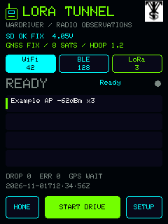
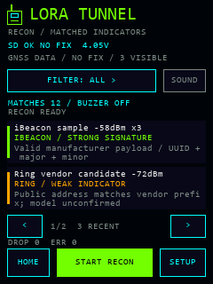
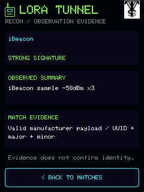

# LORA Tunnel user guide

This guide covers the Heltec Expansion Kit V2 / V4-R8 workflow for **0.5.0**. For Cardputer ADV with U214, use the [Cardputer guide](CARDPUTER_ADV.md) for keyboard controls, installation and power behavior. Both targets provide Wardriver, Recon, local logging and optional idle-only uploads.

The LoRa mode selector offers Meshtastic, MeshCore and Both / slow scan. It saves to SD while capture is stopped. Combined mode alternates one selected profile per protocol; public MeshCore announcements and supported Meshtastic payloads decode locally. [Mesh profiles and decoding scope](COMBINED_MESH.md) · [Current release record](RELEASE_0_5_0.md).

## Prepare the device

Use the [official Heltec kit information](https://heltec.org/project/v4-r8-ex/) and [hardware notes](HARDWARE.md) to confirm the board and antenna/frequency variant. Preserve stock firmware using [RECOVERY.md](RECOVERY.md), then follow the [web installer guide](WEB_FLASHER.md) or [source build instructions](../README.md#build-and-flash-from-source).

Prepare a FAT32 microSD card:

1. Copy the repository's `sdcard/lora-tunnel` directory to the card root.
2. On the card, copy `lora-tunnel/config.example.json` to `lora-tunnel/config.json`.
3. Keep `detection_rules.json` with an empty `rules` array for the built-in Recon detections. Add custom rules only when needed.
4. Insert the card and reboot. Configuration and custom detection changes are loaded at boot.

The device writes session files under `/sessions`. Storage is required to start capture. If the card was absent at boot, insert it and choose **Settings → Retry SD**; reboot to load its configuration. A full/failed card produces visible errors or drops. Stop and wait for saving to finish before removing it.

The example starts with `region: "UNSET"` and LoRa disabled. A first-run picker lets you choose a compatible region, or **Skip LoRa** and use Wi-Fi/BLE. A successfully saved Skip is remembered across reboot while LoRa stays off. The blank example leaves setup incomplete and shows the picker again if copied over the saved configuration. There is no hidden US default on a fresh installation. Existing valid US configurations from earlier versions retain their settings. Profile names must fit 39 UTF-8 bytes. [Complete SD settings and rules](../sdcard/README.md).

## Choose a LoRa region

Choose the region that matches the receiver's location and the network you intend to observe. The supported kit is Heltec's **863–928 MHz** variant; the separate **433 MHz** and **470–510 MHz** hardware variants cannot be made compatible by selecting a different software profile. An antenna appropriate for the chosen band is still required. [Official Heltec variants](https://heltec.org/project/v4-r8-ex/)

The picker selects one standard Meshtastic **LongFast** receive profile. For example, **US** uses **906.875 MHz** and **EU_868** uses **869.525 MHz**, both with 250 kHz bandwidth, SF11 and coding rate 4/5. Eighteen high-band profiles are selectable; lower-band entries are unavailable on this build. The [full region table](REGIONS.md) includes exact frequencies, modem settings, upstream revisions and hardware compatibility. Renamed channels, manual slots and nondefault presets can use different settings.

You can return to **Settings → LoRa Region** while capture is stopped and saving has finished. Applying another region replaces the radio's modem settings with that region's standard LongFast profile and LNA bypass; it leaves credentials and other valid configuration fields intact. The picker changes LoRa only. Wi-Fi observation remains on channels 1–11, and LoRa still receives one profile at a time.

With a mounted card, the firmware saves and checks the SD configuration before applying the selection, then mirrors the region code to device NVS. An SD failure keeps the previous active choice. If SD succeeds but NVS fails, the choice remains durable on that card and the interface reports the partial result. Without a card, NVS must save and read back successfully. SD is still required to record sessions.

At boot, a valid SD file takes precedence over NVS; a valid backup can recover a damaged primary. NVS is used only when the files are absent or the card is unavailable. Existing invalid files without a valid backup leave LoRa disabled rather than silently accepting an NVS fallback. Copying an explicit UNSET example over a configured card deliberately clears its LoRa choice. NVS retains a region code, not custom SD modem values or credentials. [Persistence and migration details](REGIONS.md#persistence-and-migration)

## Home and capture modes

Home offers **Wardriver**, **Recon** and **Settings**. Selecting a mode opens its view; it does not start capture. Changing to the other mode stops the old session and finishes queued writes. Start the new mode explicitly after saving finishes.

Returning Home, opening Settings or using Back alone leaves a running capture active. Home shows which mode is running. Reopen that mode to stop it.

| Control | Action |
| --- | --- |
| START DRIVE / START RECON | Begin a new recording after readiness/storage checks |
| STOP + SAVE | Stop capture and finish queued SD writes |
| HOME | Return to mode selection while preserving an active session |
| SETTINGS | Open LoRa region, credential entry, SD retry and shutdown |
| WiFi / BLE / LoRa tabs | Change Wardriver's recent-observation view |

## Wardriver

Wardriver records 2.4 GHz Wi-Fi AP observations, BLE advertisements and fixed-profile LoRa reception. Wi-Fi and BLE alternate on the ESP32-S3's shared radio. The SX1262 receives one frequency/modem profile at a time; it cannot hear every LoRa preset simultaneously.



*UI code render with synthetic sample values, not a device photograph.*

Tab counters count admitted observations, including repeat sightings. Recent rows show summaries with available names/identifiers, RSSI and sighting counts. The bounded summary cache can evict old entries; that does not remove earlier JSONL observations. BLE random addresses do not identify a permanent device. LoRa candidate headers and packet fingerprints are not authenticated identities or decoded message content.

GPS status distinguishes valid, missing and stale data. Capture can retain observations without a fix, but the WiGLE exporter will not fabricate receiver coordinates or UTC. Error/drop counters should remain visible during a drive; increasing counts need investigation before trusting completeness.

## Recon

Recon uses passive Wi-Fi/BLE observations and stops LoRa. Only enabled-category matches are logged as Recon observations; ordinary unclassified traffic does not populate the Recon result list. Categories cover ALPR/Flock, bodycams, iBeacon, Ring/camera indicators, Remote ID drones, Find My/trackers, glasses, acoustic/serial indicators, radio tools and custom rules. Category labels do not guarantee that every product in a category is detectable.

| Matches | Evidence detail |
| --- | --- |
|  |  |

*Both views are code renders with synthetic sample values. They do not demonstrate detection of those devices.*

**FILTER** cycles categories. The list retains up to eight eligible recent summaries and shows two per page; arrows page through that window. Filters do not search the entire session file. Tap a result for a stable evidence snapshot.

Evidence grades are **weak indicator**, **medium evidence** and **strong signature**. They describe matched broadcast evidence, not probabilities, authenticated identities or recording activity. A vendor prefix may cover several product families. An Apple manufacturer identifier alone does not establish an AirTag. Remote ID positions are self-reported, separate from receiver GPS, and do not prove the operator's current location. [Detection rules, provenance and limits](RECON.md).

**MUTE / SOUND** changes the current buzzer setting in RAM. Reboot restores the SD setting. The defaults display low-or-higher evidence and alert on medium-or-higher evidence. In current source, alerts require a winning rule that permits them and active Recon capture. Each observed identity receives one short motif per explicit Recon session; waiting, display-cache eviction and mute/unmute do not replay it. Stop, mode change, mute and sleep cancel sound. The separate 128-identity history suppresses new audio when full. [Original detection sounds and limits](ALERTS.md). Enabled-category matches can be logged below the display threshold. An omitted `recon.categories` enables all categories; an empty array enables none.

## Touchscreen, buttons and keyboard

The touch interface is primary. Optional physical navigation defaults to enabled:

- **IO:** move focus to the next control.
- **USER short press:** select the focused control.
- **USER held about 700 ms:** go Back once.
- Touch hides the hardware focus outline. Keyboard Back cancels and clears the temporary entry.

Physical-button electrical/function acceptance remains pending. Set `ui.buttons_enabled` to `false` on the card if using touch only.

**Settings → Connection Keys** offers WiGLE API name/token, WDGWars token and Wi-Fi SSID/password fields. Tapping one opens the keyboard only when needed. Stop capture before saving. Entries are bounded to 127 bytes; Save writes a checked temporary configuration and retains a previous valid backup. Existing secret values are not displayed as a prefilled entry.

**Version 0.5.0 supports optional uploads on both boards.** Service credentials plus explicit upload settings enable the separate idle-only uploader; see [Uploads](UPLOADS.md). Credentials are plaintext on the removable SD card; keep real `config.json`, backups and session logs out of public source archives. Leave credential fields empty if not needed.

## Shutdown and wake

Open **Settings → Power**, then choose **Power Off** in the confirmation. **Cancel** returns without stopping the session. The firmware stops any capture, waits for queued SD records to finish saving and the file to close, then stops the radios and GNSS, turns off the display/peripheral supplies and puts the ESP32 into deep sleep. Wait for that sequence to complete before removing power or the card. Cancelling the confirmation returns to Settings. Shutdown is a Settings action; holding USER during normal operation still means Back.

A new storage error/drop while closing an active session aborts shutdown and keeps the device awake. A save that has not completed within 15 seconds also aborts. Check the displayed error before retrying. After the log is closed, a separate 15-second recovery timer restarts the application idle if radio/peripheral teardown stalls; that recovery is not a completed shutdown. Holding USER at the sleep transition is refused so it cannot create an immediate wake loop. A failure after radio teardown can require a restart before capture resumes.

Press **USER** to wake from software sleep. Wake restarts the application; it does not resume the previous recording automatically. The battery remains electrically connected during deep sleep, so this is not zero-current power isolation. The GNSS backup rail can retain receiver state. Sleep-current measurement and physical wake/SD verification belong to the new-build acceptance checklist.

The physical **POWER** switch is separate. Holding it for roughly three seconds controls the expansion board's hardware battery latch, which has no MCU input in the V2.03 schematic. Firmware cannot intercept that press to flush a log. USB power may keep the device powered even when the battery latch is off. Use the software shutdown or **STOP + SAVE** first; do not use a hardware cutoff as a substitute for completing the save. [Official V2.03 power schematic](https://resource.heltec.cn/download/WiFi_LoRa_32_Expansion_Kit-V2/schematic/Expansion_board_V2.03.pdf), [Heltec V2 power-button and USB quick start](https://github.com/HelTecAutomation/HeltecWiKi/blob/main/docs/devices/open-source-hardware/esp32-series/lora-32/wifi-lora-32-v4r8/quick-start.md)

## Export a session

After **STOP + SAVE** completes, copy the original JSONL file to your computer. Run from the source directory, choosing a new output filename:

```sh
python tools/export_logs.py wigle path/to/session.jsonl path/to/new-wigle.csv
python tools/export_logs.py wdgwars-mesh-candidate path/to/session.jsonl path/to/new-mesh-candidate.json
```

The exporter leaves the original log intact and reports skipped records. WiGLE requires a valid fresh receiver fix and UTC; it excludes Recon/raw Wi-Fi frame records and randomized BLE addresses by default. No usable GPS fix can mean zero exported rows.

The mesh output is an unsigned **candidate**, not a successful WDGWars upload. It requires decoded mesh identifiers, advertised node positions, role and known forwarding information. Current LoRa capture does not decode all those fields, so it does not yet produce eligible real mesh records. Receiver coordinates cannot substitute for a relayed node's position. [Export rules and service documentation](EXPORTS.md).

## Optional USB diagnostics

Standalone capture does not require USB or a console. For bench work, use a confirmed port at 115200 baud and close other serial applications first. Console queries `tunnel status` and `tunnel gps` return bounded status without receiver coordinates or observed names. `tunnel start` and `tunnel stop` use the same session controls as the screen; `tunnel drive` and `tunnel recon` select a mode without starting it.

The host helpers require Python and `pyserial`:

```sh
python -m pip install pyserial
python tools/bench_serial.py --port PORT --command status --seconds 10
python tools/bench_serial.py --port PORT --command stop --seconds 15
python tools/bench_gps.py --port PORT --seconds 15
```

Replace `PORT` with the actual Windows COM port or Unix serial device. Both tools require it explicitly and accept bounded runs of 1–60 seconds. The GPS helper only queries diagnostics. Start/Stop require a fresh acknowledgment; Stop waits for `running=0 saving=0`. A successful helper run does not prove a position fix, SD file integrity or RF coverage. Satellite groups must not be summed as a unique-satellite count. [GNSS diagnostic interpretation](GPS_DIAGNOSTICS.md).

For a useful bug report, include firmware version, exact board revision, mode, steps, sanitized error/drop counters and whether storage/GPS reported ready. Avoid attaching credentials, raw session logs or coordinates unless you deliberately intend to share them. [Hardware acceptance checklist](TEST_CHECKLIST.md).
